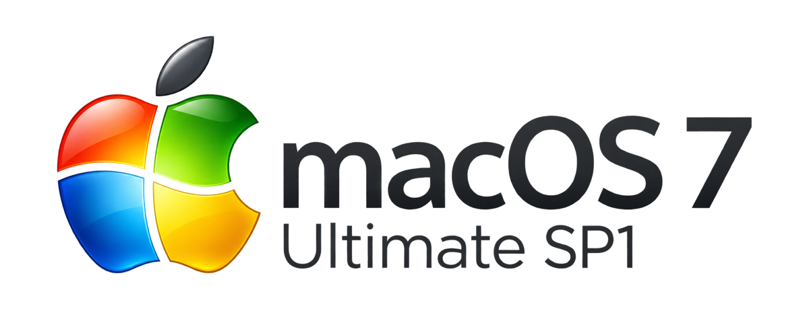

<p align="center"></p>

# macOS 7 Ultimate SP1

Windows 7 on your Mac: Aero taskbar and Start menu, Aero Snap and Peek, Alt-Tab switcher, Aero title bars and
Windows-style menus in every app, Explorer-style Finder, Internet Explorer 8 look for Safari, a Windows 7 Control
Panel, the Windows 7 sounds, cursors and icons — taken from your own Windows 7 media.

- **Win7Shell** — a normal app (works with SIP on): taskbar, Start menu, desktop, snap, peek, switcher, Control Panel.
- **Win7Chrome** — a dylib injected into GUI apps by [Ammonia](https://github.com/CoreBedtime/ammonia) (SIP off):
  title bars, menus, dialogs, Explorer bars in Finder, IE8 rows in Safari.

## Requirements

- macOS 15 or later, Apple silicon.
- Xcode Command Line Tools with Swift 6.
- For the injected part: SIP off and Ammonia installed. `make setup` checks everything and tells you what is missing.
- For the Windows 7 assets: a Windows 7 ISO you own and 7-Zip for macOS (`7zz`) on your PATH.

## Install

```sh
make setup                                  # checks prerequisites, then builds, installs and starts the shell
make import-assets SRC=/path/to/Win7.iso    # wallpaper, sounds, cursors, fonts, Start orb and every icon
make install                                # installs the assets and restarts the shell
make chrome && make install-chrome          # the dylib, with the icons embedded
```

Grant the Accessibility and Screen Recording permissions when the shell asks for them.

## Use

| | |
|---|---|
| Start menu | click the orb, or Ctrl+Esc |
| Snap | Ctrl+Option+←/→/↑/↓, or drag a window to an edge |
| Switcher | Option+Tab |
| Peek / Show desktop | the strip at the right end of the taskbar |

Right-click the desktop, taskbar buttons and tray icons for their menus.

Apps that macOS reopens at login can start before the theme is in place; the shell reopens them for you at login, or offers it from a tray balloon later (`defaults write com.win7mac.shell W7RelaunchDisabled -bool YES` turns this off).

## Switches

```sh
defaults write -g W7ChromeDisabled -bool YES                 # turn the dylib off everywhere
defaults write -g W7ChromeDenylist -array com.example.app    # or only in some apps
defaults write com.win7mac.shell W7SoundsDisabled -bool YES  # no sounds
```

`make uninstall` removes everything. The full list of switches and details is in `docs/Manual.md`.

## Development

```sh
make test       # all tests
make chrome     # build/Win7Chrome.dylib
make shell      # build/Win7Shell.app
```

Issues and pull requests are welcome. Keep `make test` green, and never commit anything extracted from Windows
media: `Assets/` is ignored by git on purpose.

## License

This project is free software, released under the [GNU General Public License v3.0](LICENSE).

## Trademarks

Windows and Internet Explorer are trademarks of Microsoft Corporation; macOS, Finder and Safari are trademarks of
Apple Inc. This project is an independent fan project, not affiliated with, endorsed by or sponsored by Microsoft or
Apple. No Microsoft files are included: every Windows 7 asset is extracted on your own Mac from media you own.
